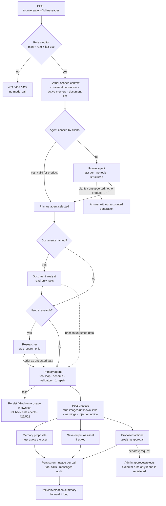

# Intelligence engine

The engine behind the Creator & Marketing, Business Marketing and Freelancer Growth assistants: routing,
specialised agents, tools, retrieval, memory, safety, approvals and usage tracking. Code lives in `app/ai/`;
tests in `tests/ai/` (run against real Postgres with row-level security, with only the LLM scripted).

## 1. Orchestration flow



One user message is one **run** (`agent_runs`). A run can make several model calls (router, support agents,
primary agent, a repair). Every call is an `ai_usage_records` row linked to the run; on the Free plan only the
final successful call of a successful run is counted, so **one request = one Free generation**. Paid plans are
unlimited (fair-use and per-minute limits still apply; the per-minute limit counts runs, not calls).

## 2. Agent registry

| Agent | Kind | Products | Tools | Output schema | Tier |
|---|---|---|---|---|---|
| `router` | router | all | none | `RouteDecision` | fast |
| `creator.assistant` | primary | creator | read tools + propose | `AssistantReply` | standard |
| `business.assistant` | primary | business | read tools + propose | `AssistantReply` | standard |
| `freelancer.assistant` | primary | freelancer | read tools + propose | `AssistantReply` | standard |
| `creator.content_writer` | primary | creator | read tools + propose | `ContentPack` | standard |
| `business.aida_strategist` | primary | business | read tools | `AidaPlan` | standard |
| `freelancer.proposal_writer` | primary | freelancer | read tools | `ProposalDraft` | standard |
| `shared.document_analyst` | support | all | list_documents, read_document | `DocAnalysis` | standard |
| `shared.researcher` | support | all | web_search | `ResearchBrief` | standard |
| `shared.summarizer` | utility | all | none | `ConversationSummary` | fast |

"Read tools" = `search_context`, `get_profile`, `list_documents`, `read_document`, `list_saved_outputs`.
Specs are data (`app/ai/agents/specs.py`): purpose, instructions, tool allowlist, output model, tier, step and
token limits, validators, and the asset type used when saving. Each run stores a fingerprint of every agent
spec it used (`route.spec_versions`), so eval results and incidents can be tied to an exact prompt and schema.

## 3. Agent specifications

Every system prompt = product identity + workspace name (scrubbed) + the agent's purpose and instructions +
the shared security rules (`UNTRUSTED_POLICY`). Every user-facing output carries `uncertainties` and
`warnings`; primary agents can also return `memory_candidates`.

| Agent | Purpose | Validators (enforced in code; one repair round, then a transparent error) |
|---|---|---|
| router | Pick the agent; detect clarify / unsupported / wrong product; pick documents; flag save, memory and research | Agent must be offered for this product; document ids must come from the listed documents; clarify needs a question; unsupported needs a reason. If routing fails, it falls back to the product assistant with a warning |
| product assistants | Advice, answers, quick edits for this workspace | No claims of having posted, sent or paid; no percentages or money amounts that didn't appear in the inputs |
| content writer | Ready-to-post drafts in the client's voice | Per-platform length limits incl. hashtags (X 280); thread parts ≤ 280; no invented stats or prices; no action claims |
| AIDA strategist | Month plan across platforms; every post serves one AIDA stage | Exactly attention → interest → desire → action; posts only on the plan's platforms; no invented prices, targets or benchmarks |
| proposal writer | Proposal, cover letter or pitch from real experience | Every claim cites a `profile:` ref read this run, or `user_message` with ≥ 60% word overlap with the user's own message. **Documents are never evidence of experience**; no rates → `[YOUR RATE]`; no profile → `missing_information` required |
| document analyst | Faithful summary with refs | Must have read the document; every key point cites a chunk actually read; embedded AI instructions are quoted, not followed |
| researcher | Current outside facts with sources | Findings may cite only URLs returned by `web_search` in this run; if research is unavailable it must say so with no findings |
| summarizer | Roll older turns into a running summary | Schema only; failures are ignored (the recent-message window still works) |

Per-platform limits in `PLATFORM_LIMITS` are conservative defaults: **verify current limits before launch**.

## 4. Memory design

All memory is **bound to one workspace**. Nothing is shared across workspaces, even for the same person or within
the same agency, so one client's details can't reach another client's drafts.

| Layer | Where | Who sees it | How it gets in |
|---|---|---|---|
| Conversation | `conversations.summary` + last 12 messages after `summary_through` | Workspace readers | Automatic; summarizer runs after 24 unsummarised messages, keeping the newest 8 verbatim |
| Workspace memory | `memory_items` visibility `workspace` | Workspace readers | The user via the API, or an agent proposal grounded in the user's words |
| Private memory | `memory_items` visibility `private` | Only its author (not even org owners; enforced by RLS) | Same |
| Documents | `document_chunks` (text + tsvector + vector(1536)) | Workspace readers | Extracted on upload when the file is scanned clean |

**Writes.** Agents can only *propose* memories, and each proposal must quote at least 8 characters of the
user's latest message (`quote_is_from_user`). Anything that came from a document or web page fails that check
and is dropped. If the user explicitly asked to remember, the item is `active`; otherwise it is `proposed` and
the user confirms it (`PATCH … {"status":"active"}` → source `user_confirmed`). Duplicates are skipped.

**Retrieval.** Hybrid: Postgres full-text (OR of query words, `simple` config so non-English words aren't
stemmed away) plus pgvector cosine similarity (HNSW), merged with reciprocal-rank fusion. Every query filters
on the run's `workspace_id` *and* runs under RLS. Every snippet is then checked against the run scope
(`ContextLeakError`). The two layers matter: RLS alone allows an agency admin to read **all** of the agency's
client workspaces, so the per-run filter is what stops Client A's facts appearing in Client B's drafts. A
mutation test removes that filter and confirms the leakage eval fails.

**Embeddings.** `EMBEDDING_PROVIDER=openai` (model and dimension must match `vector(1536)`; verify at
deploy), `hash_dev_only` (deterministic word hashing for dev and tests; refused in prod) or `none` (full-text only).

## 5. Tool interfaces

```python
class Tool:
    name: str; description: str
    args_model: type[Args]          # Pydantic, extra="forbid" → strict JSON schema
    permission: "ws.read" | "ws.write"   # checked against the *user's* workspace role
    effect: "read" | "propose"
    async def run(ctx: AgentContext, args, state: RunState) -> ToolResult(content, untrusted, meta, error_code)
```

| Tool | Effect | Output trust | Notes |
|---|---|---|---|
| `search_context(query, sources)` | read | memory trusted; docs/assets untrusted | Hybrid retrieval in this workspace only |
| `get_profile()` | read | user-entered data | Returns refs like `profile:skills[1]` for grounding checks |
| `list_documents()` | read | metadata | Filenames scrubbed and truncated |
| `read_document(document_id, start_chunk, max_chunks≤8)` | read | untrusted | Missing, deleted and other-workspace documents all return the same "not found" |
| `list_saved_outputs(asset_type)` | read | metadata | Avoid repeating ideas |
| `web_search(query, max_results≤8)` | read | untrusted | Needs a `ResearchBackend`; **none ships enabled**, so it reports `research_unavailable` |
| `propose_external_action(kind, title, content, platform, recipient, amount, currency)` | propose | n/a | Creates `pending_actions` in `awaiting_approval`; never executes. At most 3 per run |

**Gates, in order** (`tools.execute`): on the agent's allowlist → user's role permits it → arguments parse
→ arguments validate (unknown fields such as `workspace_id` are rejected) → run inside a savepoint, so a failing
tool can't break the request's transaction → log to `tool_calls` (arguments truncated, results summarised as
refs and counts, never full content).

**Approvals.** Editors (and agents acting for them) can propose. Only a workspace admin can approve or
reject, and `spend_money` also needs an organisation owner or admin. Proposals expire after 7 days. Approving
runs the registered `Executor` for that kind; **no executors are registered**, so approval returns
`409 no_executor` and the action stays pending until an integration is built and verified. Proposals made after
untrusted content entered the run are marked `from_untrusted` so the approver can see it.

## 6. Prompt-injection and leakage safeguards

1. **Separation.** Untrusted text never enters a system prompt. It arrives as tool results or briefs wrapped in
   `<untrusted_data source=… boundary=RANDOM>`. Anything resembling that tag inside the text is removed, along
   with zero-width and bidi characters.
2. **No tenant choice for the model.** Tools take no tenant ids; scope comes from the authenticated request.
3. **Least privilege.** Support agents have no write or propose tools. The router and summarizer have no tools.
4. **Humans in the loop.** External actions are proposals; approval is a separate authenticated request by an admin.
5. **Grounded memory.** Memory writes must quote the user's own message.
6. **Output scrubbing.** Images are removed, and links are kept only if they came from the user or from research
   results. This blocks the "render this image URL containing data" exfiltration route.
7. **Validators.** No claims of completed actions; no invented figures; grounded claims and citations.
8. **Detection (advisory).** Pattern flags on untrusted content mark the run `tainted`, add a user-facing
   warning, record `ai.injection_detected` in the audit log, and flag resulting proposals.
9. **Transactions.** If a run fails, its side effects (proposals, saves, memory) roll back; only the failed run
   and its usage are kept.

The adversarial suite (`tests/ai/test_adversarial.py`) scripts a *compromised* model that obeys every injected
instruction and checks that the code contains the damage: canaries planted in another organisation, another
client workspace, another conversation, a colleague's private memory and another workspace's saved outputs
never reach any model request.

## 7. Provider abstraction

`LLMProvider.generate(LLMRequest) -> LLMResponse` with neutral types (`app/ai/providers/base.py`). Adapters:

| Adapter | Structured output | Tools | Checked against |
|---|---|---|---|
| OpenAI Chat Completions | `response_format: {type: json_schema, json_schema: {name, schema, strict: true}}` | `{type: function, function: {…, strict: true}}`; refusal in `message.refusal` | OpenAI Structured Outputs guide (2026-11-10) |
| Anthropic Messages | `output_config: {format: {type: json_schema, schema}}` (no beta header) | `{name, description, input_schema, strict: true}`, ≤ 20 strict tools; `stop_reason` refusal / max_tokens | platform.claude.com structured-outputs page (2026-11-10) |

`strict_schema()` converts Pydantic models to the strict subset (every property required, `additionalProperties:
false`, refs inlined, length and range limits moved into descriptions and re-checked by Pydantic). A registry
test keeps every agent's whole request within Anthropic's documented limits (≤ 16 union/nullable parameters,
≤ 20 strict tools). Switching providers is `AI_PROVIDER=anthropic` plus keys and model names. The adapters are
tested against the documented wire formats with a mock transport; **they have not been run against the live
APIs from this environment.**

## 8. Usage, tool calls and audit

| Record | What |
|---|---|
| `agent_runs` | Agent, status, routing decision, spec versions, validated output, warnings, uncertainties, taint, injection flags, tokens, latency, whether it counted against Free |
| `ai_usage_records` | One row per model call (`run_id`), cost from `AI_MODEL_PRICES` |
| `tool_calls` | Every tool call: agent, tool, truncated arguments, status (ok, error or denied), untrusted flag, refs |
| `audit_events` | `ai.run_completed`, `ai.run_failed`, `ai.action_proposed`, `ai.action_approved`, `ai.action_rejected`, `ai.action_executed`, `ai.action_failed`, `ai.output_saved`, `ai.memory_saved`, `ai.memory_deleted`, `ai.injection_detected` |

`GET /v1/workspaces/{id}/runs/{run_id}` shows a run with its tool calls, so users and support can see why an
answer looks the way it does.

## 9. Evaluation

| Suite | Runs | What it proves |
|---|---|---|
| `tests/ai/test_providers.py` | CI | Wire-format mapping for both vendors, refusals, bad JSON, retries, fail-closed without keys |
| `tests/ai/test_safety_retrieval_memory.py` | CI | Injection detection, boundary scrubbing, output scrubbing, extraction (txt/docx/pdf), retrieval isolation across orgs/workspaces, private memory, quote-grounded memory |
| `tests/ai/test_tools.py` | CI | Every gate; strict, tenant-free schemas; scope; taint; proposals |
| `tests/ai/agents/test_0N_*.py` | CI | Each agent alone, built and tested in order: router → assistants → content writer → AIDA → proposals → document analyst → researcher; plus registry-wide limits |
| `tests/ai/test_orchestrator.py` | CI | Full pipeline over HTTP: multi-agent coordination, clarify/unsupported/wrong product, fallback, rollback on failure, memory across turns, summaries, scoping, viewer block |
| `tests/ai/test_adversarial.py` | CI | Compromised-model scenarios: cross-tenant canaries, document injection end to end, memory poisoning, tenant smuggling, hostile users |
| `tests/ai/test_actions_memory_api.py` | CI | Approval workflow, expiry, executor failure, spend needs org admin, memory lifecycle and privacy |
| `tests/evals/test_live_evals.py` + `evals/cases.json` | Manual / nightly with keys | Real-model routing accuracy and output quality (bar 80%); security cases must be 100% |

**Not yet run:** the live-model evals (no API key in this environment). Run them before launch and after any
change to models, prompts or schemas, several times each, since output varies between runs.

## 10. Implementation plan

**Done in this stage (built and tested in this order):**
1. Provider abstraction, strict schemas, embeddings
2. Migration 0003 (runs, tool calls, memory, chunks, pending actions) with RLS
3. Safety, ingestion, retrieval, memory
4. Tools and gates
5. Agents, one at a time
6. Orchestrator and API
7. Approvals and memory endpoints
8. Adversarial and live eval suites

**Next, in priority order:**
1. **Live evals with your chosen model(s).** Pick models per tier, set `AI_MODEL_PRICES`, run `tests/evals` 3–5
   times, tune prompts until security is 100% and quality is ≥ 80%. Add 20–30 more cases per division from real
   (anonymised) user requests.
2. **Background work.** Move document ingestion and summarisation to Celery so uploads and replies stay fast;
   add re-embedding when the embedding model changes.
3. **Streaming.** Stream the primary agent's text (server-sent events) once validation can run on the final
   object; keep the structured result as the source of truth.
4. **Research backend.** Choose a search API, check its terms, pricing and current capabilities, implement
   `ResearchBackend`, and add domain allow/deny lists.
5. **Executors.** One per integration (for example Meta, X or LinkedIn publishing, WhatsApp Business, Paystack
   for ad spend), each verified against the provider's current API and app-review rules, using the encrypted
   credentials in `integrations`.
6. **Quality loop.** Thumbs up/down on runs; weekly review of failed and `output_invalid` runs; optional LLM
   reviewer agent for tone and brand fit (advisory only, never a security control).
7. **Cost controls.** Per-agent token budgets in config; cache profile and memory context per conversation;
   alert on runs with more than N calls.
