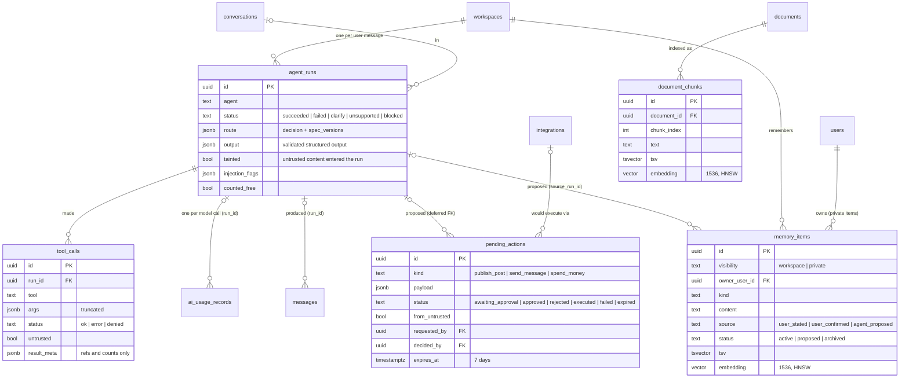

# Entity relationship diagram

Source of truth: `migrations/versions/0001_core_schema.py` (tables, constraints, indexes) and
`0002_rls_policies.py` (row-level security). Every workspace-scoped table carries both
`workspace_id` and `org_id`, linked by a composite foreign key to `workspaces(id, org_id)`.
That means a row can never claim one organisation while pointing at another organisation's workspace.

```mermaid
erDiagram
    users ||--o{ refresh_tokens : "has sessions"
    users ||--o{ organisations : "owns (1 personal org)"
    users ||--o{ org_members : "belongs to"
    organisations ||--o{ org_members : "has"
    organisations ||--o{ teams : "has"
    teams ||--o{ team_members : "has"
    org_members ||--o{ team_members : "is"
    organisations ||--o{ product_access : "enables creator / business / freelancer"
    plans ||--o{ subscriptions : "priced as"
    organisations ||--o{ subscriptions : "pays (max 1 live)"
    organisations ||--o{ usage_counters : "Free plan monthly count"
    organisations ||--o{ workspaces : "contains"
    workspaces ||--o{ workspace_members : "has"
    org_members ||--o{ workspace_members : "is"
    workspaces ||--o{ projects : "has"
    workspaces ||--o| client_accounts : "D1 creator: one client"
    workspaces ||--o| business_profiles : "D2 business"
    workspaces ||--o| professional_profiles : "D3 freelancer"
    users ||--o{ professional_profiles : "is about"
    workspaces ||--o{ documents : "stores"
    projects |o--o{ documents : "groups"
    workspaces ||--o{ conversations : "has"
    conversations ||--o{ messages : "contains"
    workspaces ||--o{ assets : "saved outputs"
    projects |o--o{ assets : "groups"
    assets ||--o{ asset_versions : "versioned"
    assets |o--o{ messages : "saved from"
    organisations ||--o{ ai_usage_records : "every AI call"
    workspaces |o--o{ ai_usage_records : "in"
    ai_usage_records |o--o{ messages : "produced"
    ai_usage_records |o--o{ asset_versions : "produced"
    organisations ||--o{ integrations : "connects"
    workspaces |o--o{ integrations : "scoped to"
    organisations |o--o{ audit_events : "logs"
    users |o--o{ audit_events : "acted"

    users { uuid id PK
        citext email UK
        text password_hash "argon2id, null for external IdP"
        text external_subject UK
        int failed_logins
        timestamptz locked_until }
    refresh_tokens { uuid id PK
        uuid user_id FK
        uuid family_id "reuse revokes family"
        text token_hash UK "sha256, raw never stored"
        timestamptz expires_at
        timestamptz revoked_at }
    organisations { uuid id PK
        text kind "personal | team"
        uuid owner_user_id FK
        timestamptz deleted_at }
    org_members { uuid org_id PK
        uuid user_id PK
        text role "owner | admin | member | billing" }
    teams { uuid id PK
        uuid org_id FK
        text name "unique per org" }
    team_members { uuid team_id PK
        uuid user_id PK
        uuid org_id FK }
    product_access { uuid org_id PK
        text product PK
        text status }
    plans { text code PK "free | starter | pro | team"
        bool ai_unlimited
        int free_monthly_limit "30 on free, null on paid"
        int max_workspaces
        int max_seats }
    subscriptions { uuid id PK
        uuid org_id FK
        text plan_code FK
        text status "active | past_due | cancelled | expired"
        timestamptz period_start
        timestamptz period_end
        bool auto_renew
        timestamptz grace_until }
    usage_counters { uuid org_id PK
        date period_month PK
        int free_generations_used }
    webhook_events { uuid id PK
        text provider
        text event_id "unique with provider: idempotency"
        jsonb payload }
    workspaces { uuid id PK
        uuid org_id FK
        text product
        text name
        timestamptz deleted_at }
    workspace_members { uuid workspace_id PK
        uuid user_id PK
        text role "admin | editor | viewer | client_approver" }
    projects { uuid id PK
        uuid workspace_id FK
        text status }
    client_accounts { uuid id PK
        uuid workspace_id FK "unique"
        text client_name
        jsonb brand_voice
        int version }
    business_profiles { uuid id PK
        uuid workspace_id FK "unique"
        text business_name
        jsonb offers
        text primary_goal
        int version }
    professional_profiles { uuid id PK
        uuid workspace_id FK "unique"
        uuid user_id FK
        jsonb experiences
        jsonb rates
        int version }
    documents { uuid id PK
        uuid workspace_id FK
        text content_type "sniffed allow-list"
        char sha256
        text storage_key UK "org/ws prefixed"
        text scan_status "pending | clean | rejected" }
    conversations { uuid id PK
        uuid workspace_id FK
        text title }
    messages { uuid id PK
        uuid conversation_id FK
        text role "user | assistant"
        text content
        uuid usage_record_id FK }
    assets { uuid id PK
        uuid workspace_id FK
        text type
        text status "draft | in_review | approved | posted | archived"
        int current_version
        text_array tags "GIN index" }
    asset_versions { uuid id PK
        uuid asset_id FK
        int version "unique per asset"
        jsonb body
        text source "ai | human" }
    ai_usage_records { uuid id PK
        uuid org_id FK
        uuid user_id FK
        text agent
        text status "succeeded | failed"
        int tokens_in
        int tokens_out
        numeric cost_usd
        bool counted_free }
    integrations { uuid id PK
        uuid org_id FK
        text provider
        bytea encrypted_credentials "Fernet"
        text status }
    audit_events { bigint id PK
        uuid org_id FK
        uuid actor_user_id FK
        text action "noun.verb"
        jsonb metadata "secrets redacted"
        inet ip }
```

## Key constraints

| Rule | How it is enforced |
|---|---|
| One personal organisation per user | Partial unique index `organisations_one_personal_uq` |
| At most one live subscription per organisation | Partial unique index on `subscriptions(org_id)` where status is active, past_due or cancelled |
| Free plan has a limit; paid plans do not | CHECK on `plans`: `ai_unlimited` and `free_monthly_limit` are mutually exclusive |
| Workspace rows can't drift across organisations | Composite FKs `(workspace_id, org_id)` → `workspaces(id, org_id)` |
| Team and workspace members must be organisation members | Composite FKs `(org_id, user_id)` → `org_members` |
| Projects, assets and messages stay inside their workspace | Composite FKs `(project_id, workspace_id)`, `(asset_id, workspace_id)`, `(conversation_id, workspace_id)` |
| Audit log is append-only | `audit_events_immutable` trigger; the app role has only SELECT and INSERT |
| Webhooks processed once | Unique `(provider, event_id)` |
| Uploaded file types | CHECK allow-list on `documents.content_type`, set from sniffed bytes, not the client header |

## Tenant isolation (row-level security)

The API connects as `eco_app`, which is `NOBYPASSRLS` and does not own any table. Each request
transaction runs `set_config('app.user_id', …, true)`, so every query is filtered by policies in
`0002_rls_policies.py`:

- **Organisation tables**: visible to members (`app.is_org_member`). Admin-only writes use `app.is_org_admin`.
- **Workspace tables**: read needs `app.can_read_ws` (org owner/admin, or workspace admin/editor/viewer).
  Write needs `app.can_write_ws` (org owner/admin, or workspace admin/editor).
  `client_approver` gets no general workspace access.
- **Billing, counters, refresh tokens, webhooks**: written only inside a short `system` context opened by server code
  (`app.context = 'system'`). That context can't be reached from request input.
- **Freelancer workspaces** live only in the user's personal organisation and can't have other members, so
  personal career data is never visible to an employer's or agency's organisation.

## AI engine tables (migration 0003)

Full design: [AI_ENGINE.md](AI_ENGINE.md). All five tables are workspace-scoped with the same composite
`(workspace_id, org_id)` foreign key and row-level security as the core tables.

| Rule | Enforcement |
|---|---|
| Private memory only visible to its author | RLS: `visibility = 'workspace' OR owner_user_id = app.uid()` on select/update/delete |
| Only workspace admins (or org owner/admin) decide actions | RLS update policy on `pending_actions` + API checks (`spend_money` also needs org owner/admin) |
| Proposals are created only as `awaiting_approval` by the requester | RLS insert check |
| Runs and tool calls are an append-only record for the app role | Only SELECT and INSERT granted |
| A decided action records who decided | CHECK: `decided_by` set exactly when status isn't `awaiting_approval`/`expired` |
| Failed runs leave no proposals behind | Deferred FK to `agent_runs` + request transaction rollback |
